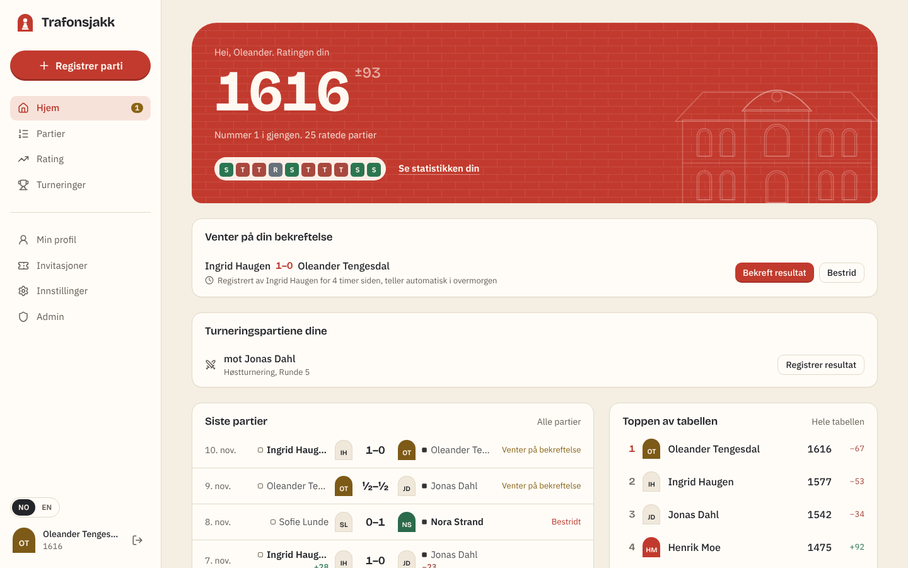
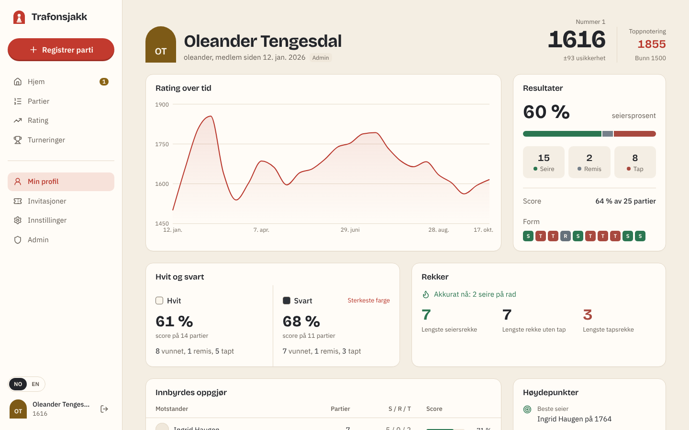
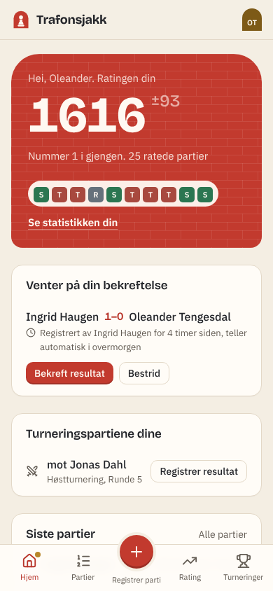
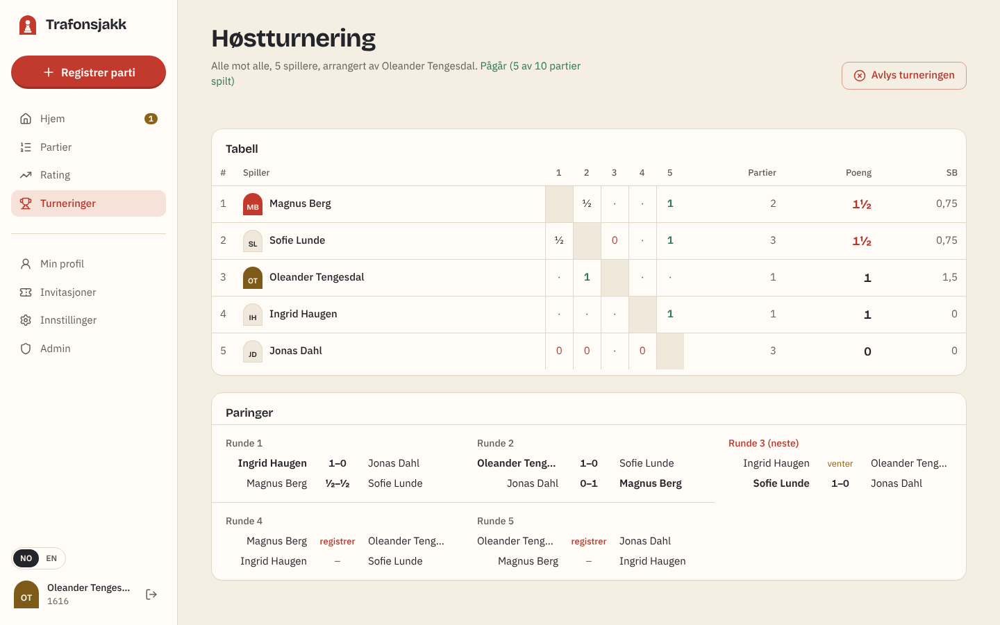
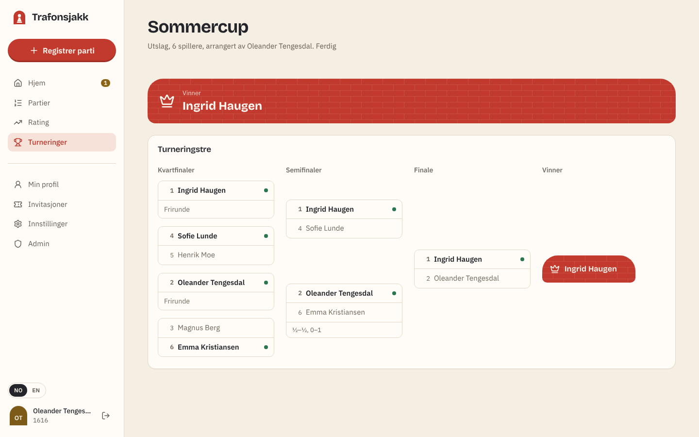
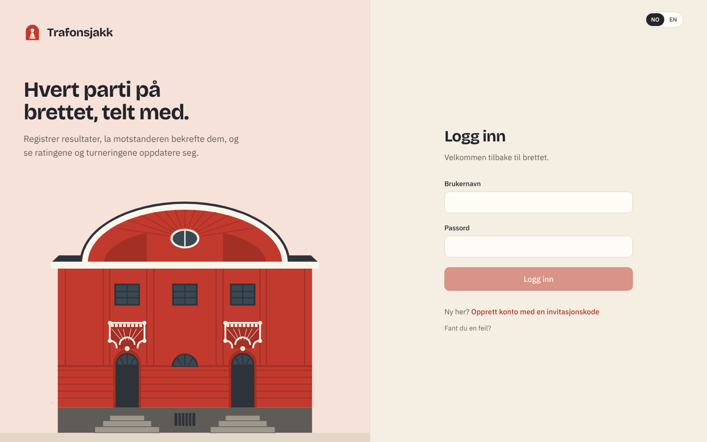

# Trafonsjakk

Ratings, results and tournaments for a friend group's **over-the-board** chess. In Norwegian and English.

Play on a real board, log the result in a few taps, and your opponent confirms it. Glicko-2 ratings, statistics and tournament tables update by themselves.



## Features

- **Log a physical game** in seconds: opponent, colour, result, when. Opening and notes are optional.
- **Record the moves** on a board (tap or drag, every move checked for legality, pawn promotion, undo) or type/paste them as `e4 e5 Nf3` or a whole PGN. Moves can also be added later from the game page.
- **The game page:** replay the moves on a board (buttons, arrow keys or tap a move) with move statistics, see each side's expected score before the game, upsets and the head-to-head, give kudos and comment, with replies and likes.
- **Player of the month:** a monthly award for whoever beat their rating's expectations the most (so the underdog can win, not just the strongest), plus one for the most active player. Winners get a badge on their profile, and the home page shows this month's race.
- **Opponent confirmation.** A result counts once the other player confirms it, or automatically after 48 hours. Disputes go to an admin.
- **Glicko-2 ratings**, updated after every confirmed game, with a rating deviation (±) and provisional "?" for new players. Ratings are always rebuilt from the game history, so late, corrected or voided results never leave them wrong.
- **Tournaments**
  - *Round-robin* (single or double): Berger pairings with balanced colours, and a live crosstable with Sonneborn–Berger tie-breaks.
  - *Knockout*: seeded bracket with byes for top seeds. Winners advance automatically; draws are replayed with colours reversed.
- **Player statistics:** rating graph, W/D/L, white vs black, streaks, head-to-head against every friend, nemesis, best win, favourite opening, activity.
- **Invite-only sign-up.** Members make single-use codes; admins can make one code for a whole group, with their own limit and expiry.
- **Admin tools** for disputes and members, including a one-time link for someone who forgot their password.
- **Norsk og engelsk:** Norwegian (bokmål) by default with English one tap away. Dates, numbers and even server error messages follow the chosen language.
- A warm **light theme inspired by the Trafon building** (red facade, cream trim, arched windows) with a tuned dark mode. Fully responsive, with a mobile tab bar and a big red "Log game" button.

<table>
<tr>
<td width="60%"></td>
<td width="40%"></td>
</tr>
<tr>
<td></td>
<td></td>
</tr>
<tr>
<td colspan="2"></td>
</tr>
</table>

## Tech stack

| | |
|---|---|
| **Backend** | Java 21, Spring Boot 4 (Web MVC, Data JPA, Security with Nimbus JOSE for JWT), Flyway, PostgreSQL |
| **Frontend** | React 19, TypeScript, Vite, Tailwind CSS 4, TanStack Query, React Router, Recharts, Lucide; typed nb/en i18n |
| **Auth** | Stateless JWT in HttpOnly cookies, rotating refresh tokens with reuse detection, BCrypt, CSRF double-submit, login lockout |
| **Tests** | JUnit 6 unit tests plus API tests that run the real app against PostgreSQL; Vitest + Testing Library on the frontend |
| **Hosting** | Vercel (frontend + `/api` proxy) · Render (API, Docker) · Neon (Postgres), all on free tiers |

## Quick start

```bash
docker compose up -d                          # PostgreSQL on localhost:5432
cd backend && mvn spring-boot:run             # API on :8080 (dev profile, no config needed)
cd frontend && npm install && npm run dev     # app on :5173
```

Open <http://localhost:5173/register> and use the invite code `let-me-in`. The first account becomes admin. Switch language with the NO/EN toggle.

Full instructions: **[docs/DEVELOPMENT.md](docs/DEVELOPMENT.md)**

## Documentation

| Doc | What's in it |
|---|---|
| [ROADMAP.md](docs/ROADMAP.md) | Product decisions, assumptions, build phases, ideas |
| [ARCHITECTURE.md](docs/ARCHITECTURE.md) | ER diagram, backend design, Glicko-2 and tournament algorithms, frontend structure |
| [API.md](docs/API.md) | Every REST endpoint and payload |
| [SECURITY.md](docs/SECURITY.md) | Threat model, mitigations, secrets inventory |
| [DEVELOPMENT.md](docs/DEVELOPMENT.md) | Running locally, tests, project layout, troubleshooting |
| [DEPLOYMENT.md](docs/DEPLOYMENT.md) | Step-by-step deploy to Neon + Render + Vercel |

## Secrets

This repository contains **no secrets**. Production values (`JWT_SECRET`, database credentials, the one-time `BOOTSTRAP_INVITE_CODE`) live only in the hosting provider's environment settings. `.env*` files are git-ignored, `*.env.example` files show what's needed, and CI runs [gitleaks](https://github.com/gitleaks/gitleaks) on every push. See [SECURITY.md](docs/SECURITY.md#secrets-inventory).

## Project structure

```
backend/     Spring Boot API (feature packages: auth, game, social, rating, award, tournament, stats, …)
frontend/    React SPA (api client, design-system components, pages)
docs/        Architecture, API, security, development and deployment guides
```

## Credits

- Move legality: [chess.js](https://github.com/jhlywa/chess.js) (BSD-2-Clause). Board: [react-chessboard](https://github.com/Clariity/react-chessboard) (MIT).
- Chess piece graphics by Colin M.L. Burnett, used under the BSD license (via react-chessboard).
