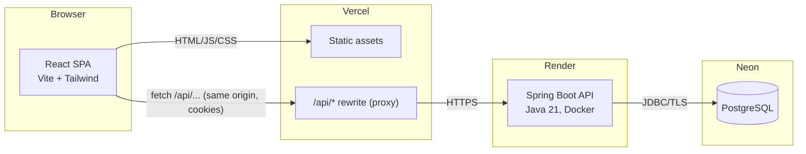
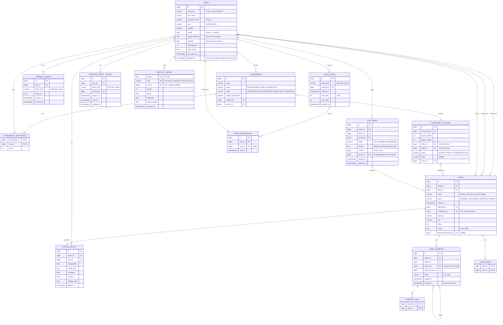
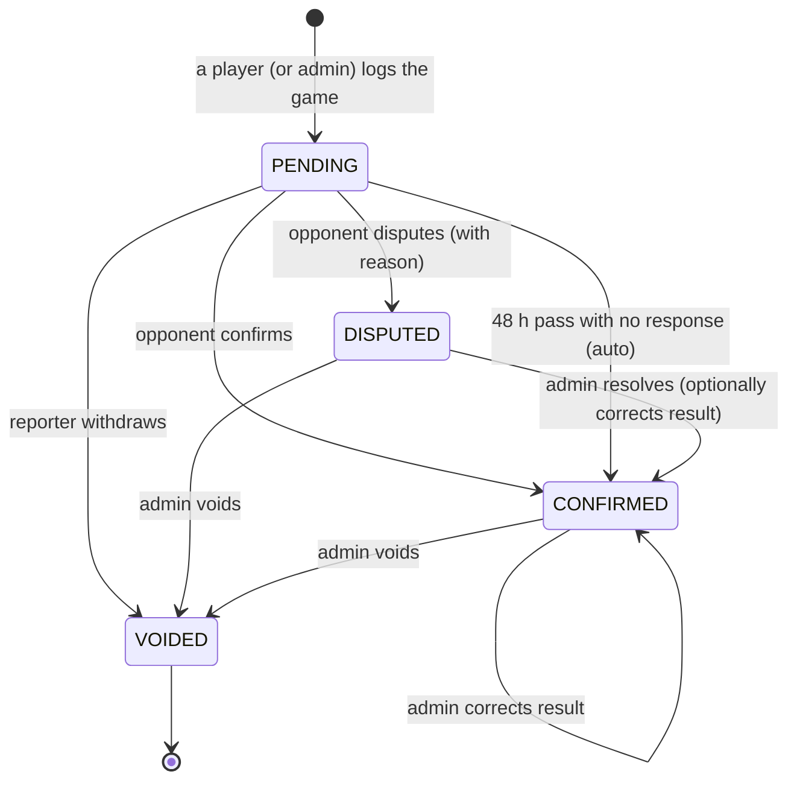
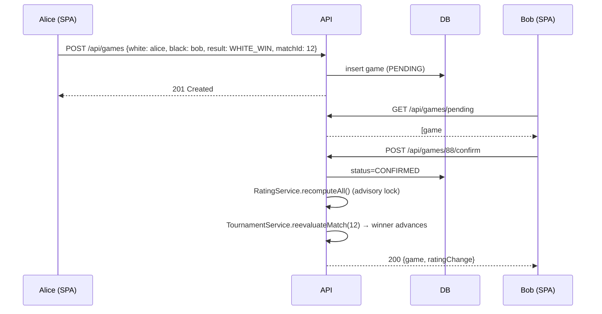

# Trafonsjakk — Architecture

This document is the technical plan for Trafonsjakk: the database, the backend, the frontend and how they fit together. It was written before the code and is kept in sync with it.

- Product decisions and the build roadmap: [ROADMAP.md](ROADMAP.md)
- Security model: [SECURITY.md](SECURITY.md)
- REST API reference: [API.md](API.md)
- Running locally: [DEVELOPMENT.md](DEVELOPMENT.md)
- Hosting: [DEPLOYMENT.md](DEPLOYMENT.md)

---

## 1. System overview



**Key choice: one origin.** In production the browser only ever talks to the Vercel domain. Vercel serves the SPA and *proxies* `/api/*` to the Spring Boot service. Because API calls are same-origin:

- auth cookies are first-party (`SameSite=Lax/Strict` works and Safari/Firefox third-party-cookie blocking doesn't apply),
- no CORS configuration is needed at all (the API rejects cross-origin browser calls by default),
- CSRF protection uses the standard double-submit cookie pattern, enforced for logged-in users too (see [SECURITY.md](SECURITY.md)).

In local development the Vite dev server does the same proxying, so dev and prod behave identically.

---

## 2. Database schema

PostgreSQL 16. The schema is owned by **Flyway** migrations in `backend/src/main/resources/db/migration`; Hibernate runs with `ddl-auto=validate` and never changes the schema.

### 2.1 ER diagram



### 2.2 Design notes

| Decision | Why |
|---|---|
| **Ratings on `users` are a cache.** The source of truth is the ordered list of `CONFIRMED` games. | Results can be confirmed late, disputed, corrected or voided. Recomputing from scratch keeps every rating and graph exactly right, no matter the order things happen in (see §3.4). |
| `rating_history` has one row per player per confirmed game | Powers the rating graph and "rating change" badges without recalculation on read. Rebuilt with the ratings. |
| Case-insensitive unique username via `UNIQUE INDEX ON users (lower(username))` | `Magnus` and `magnus` can't both exist; no `citext` extension needed (Neon/Render friendly). |
| Invite codes and refresh tokens are stored as **SHA-256 hashes** | A database leak doesn't hand out working invites or sessions. |
| `CHECK (white_id <> black_id)`, `CHECK` constraints on all enum columns | The database rejects impossible data even if a bug slips through. |
| Partial unique index: one *open* (`PENDING`/`DISPUTED`) game per tournament match | Prevents two people logging the same tournament game at once. |
| `version` columns on `games`, `tournaments`, `tournament_matches` | Optimistic locking: two simultaneous confirmations can't both win. |
| Likes and kudos have a composite primary key and are inserted with `on conflict do nothing` | One per person, so double taps can't inflate counts. |
| `monthly_awards` rows are written once and never updated | A decided month stays decided, even if an old game is corrected later (see §3.7). |
| Indexes on `(white_id, played_at)`, `(black_id, played_at)`, `(status, created_at)`, `(user_id, played_at)` on history | Profile pages, auto-confirm sweep and rating graphs are all index scans. |

The full DDL is in the Flyway migrations: [`V1__init.sql`](../backend/src/main/resources/db/migration/V1__init.sql) (core tables), `V2` (multi-use invites, password links, comments, kudos), `V3` (comment replies and likes) and `V4` (monthly awards).

---

## 3. Backend (Spring Boot)

### 3.1 Stack

| Concern | Choice |
|---|---|
| Runtime | Java 21, Spring Boot 4.1 |
| Web | Spring Web MVC (REST, JSON), Bean Validation |
| Persistence | Spring Data JPA (Hibernate 7), Flyway, PostgreSQL driver |
| Security | Spring Security 7, Nimbus JOSE (HS256 signing and validation) via a cookie filter (`CookieJwtAuthenticationFilter`), BCrypt |
| Caching / rate limits | Caffeine (in-memory; single instance) |
| Tests | JUnit 6: unit tests for the algorithm classes, and API tests that run the whole app against PostgreSQL |

### 3.2 Package layout (feature-first)

```
no.trafonsjakk
├── TrafonsjakkApplication
├── config/        SecurityConfig, JwtConfig, AppProperties, SpaCsrfTokenRequestHandler,
│                  CookieJwtAuthenticationFilter, ControlCharacterFilter, ProblemWriter,
│                  RequestSizeLimitFilter, DeploymentSafetyCheck
├── common/        ApiException, GlobalExceptionHandler (RFC 7807), CurrentUser, Tokens, ClientAddress,
│                  validation/PlainText
├── auth/          AuthController, AuthService, TokenService, AuthCookies,
│                  LoginAttemptService, RefreshToken(+Repository),
│                  InviteCode, InviteRedemption (+Repositories), InviteService, InviteController,
│                  PasswordResetToken(+Repository), PasswordResetService
├── user/          User, Role, PlayerRef, UserRepository, UserService, UserController
│                  (profile and statistics endpoints), AccountService (your data, deleting)
├── live/          LiveGame(+Repository), LiveGameService, LiveGameController, LiveDtos
├── game/          Game, GameResult, GameStatus, GameRepository, GameService, GameMapper,
│                  GameController, AutoConfirmService, GameContextService
├── social/        GameComment(+Repository), CommentLikeRepository, KudosRepository,
│                  SocialService, SocialController
├── rating/        Glicko2 (pure math), RatingHistory(+Repository),
│                  RatingService (recompute), LeaderboardService, LeaderboardController
├── award/         MonthlyAwardCalculator (pure), AwardRepository, AwardService, AwardController
├── review/        YearReviewCalculator (pure), YearReviewService, YearReviewController, YearReviewDtos
├── tournament/    Tournament, TournamentMatch, TournamentParticipant, enums,
│                  repositories, TournamentService, TournamentController,
│                  RoundRobinScheduler, KnockoutBracket, StandingsCalculator (pure)
├── stats/         PlayerStatsCalculator (pure), StatsService
└── admin/         AdminController
```

Algorithm classes (`Glicko2`, `RoundRobinScheduler`, `KnockoutBracket`, `StandingsCalculator`, `PlayerStatsCalculator`, `MonthlyAwardCalculator`, `YearReviewCalculator`) are plain Java with no Spring or JPA imports. They're easy to unit test and easy to reason about.

### 3.3 Game lifecycle (opponent confirmation)



- Only the two players (or an admin) may log a game.
- If a player logged it, **the other player** confirms. If an admin logged it on behalf of two others, **either** player may confirm.
- Only `CONFIRMED` games affect ratings, statistics and tournaments.
- **Auto-confirm:** a scheduled job runs every 10 minutes and confirms `PENDING` games older than 48 h. Free hosting sleeps when idle, so the same sweep also runs on startup and before game, leaderboard, profile, tournament and awards reads. That makes it correct even if the scheduler never fired.

### 3.4 Rating engine: Glicko-2

**Why Glicko-2:** a friend group plays in bursts. Glicko-2 tracks a *rating deviation* (RD, how sure we are) and a *volatility* (how erratic a player is). New or inactive players move quickly; regulars are stable. It's the system used by lichess.

**Parameters**

| Parameter | Value |
|---|---|
| Initial rating / RD / volatility | 1500 / 350 / 0.06 |
| System constant τ | 0.5 |
| Convergence ε | 0.000001 |
| Rating period | **one game** (instant updates, lichess-style) |
| Inactivity | before each game, RD grows as `φ* = √(φ² + σ²·t)` where `t` = days since the player's last game ÷ 7. Capped at 350. |
| Provisional | RD > 110 → shown with a "?" and excluded from the "ranked" leaderboard |

**Update for one game** (Glickman's algorithm, applied to each player using both players' *pre-game* values):

1. Convert to the Glicko-2 scale: `μ = (r − 1500) / 173.7178`, `φ = RD / 173.7178`.
2. `g(φⱼ) = 1 / √(1 + 3φⱼ² / π²)`, `E = 1 / (1 + exp(−g(φⱼ)(μ − μⱼ)))`.
3. `v = 1 / (g² · E · (1 − E))`, `Δ = v · g · (s − E)` where `s` ∈ {1, ½, 0}.
4. Solve for the new volatility σ′ with the Illinois (regula falsi) iteration from the paper.
5. `φ* = √(φ² + σ′²)`, `φ′ = 1 / √(1/φ*² + 1/v)`, `μ′ = μ + φ′² · g · (s − E)`.
6. Convert back: `r′ = 173.7178 μ′ + 1500`, `RD′ = 173.7178 φ′`.

The implementation is verified against the worked example in Glickman's paper (1500/200/0.06 vs three opponents → 1464.06 / 151.52 / 0.05999).

**Recompute, don't patch.** Whenever the set of confirmed games changes (confirm, auto-confirm, admin correction, void), `RatingService.recomputeAll()`:

1. takes a PostgreSQL transaction-level advisory lock, so only one recompute runs at a time,
2. resets every player to 1500/350/0.06,
3. replays all `CONFIRMED` games ordered by `(played_at, id)`,
4. rewrites `rating_history` and the cached rating columns on `users` in one transaction.

For a friend group (hundreds to a few thousand games) this takes milliseconds. It makes back-dated games, late confirmations and voids exactly correct. If the group ever reaches ~50k games, switch to an incremental update for games that land at the end of the timeline.

### 3.5 Tournament engine

**Creating:** any member creates a tournament, picks a format and adds participants (2–32). Members can join or leave while it's in `REGISTRATION`. The creator or an admin starts it; starting freezes the player list, assigns seeds by current rating and generates every fixture at once.

**Round-robin (Berger / circle method)**

- With an odd player count, a "bye" placeholder is added; whoever is paired with it rests that round (no match row is created).
- Player 1 stays fixed and the rest rotate one place each round, giving `n − 1` rounds of `n / 2` pairings.
- Colours are assigned greedily so every player's white and black counts differ by at most one. The tests check this.
- **Double round-robin** repeats the schedule with colours swapped.
- All pairings are playable straight away: friends meet when they can, and the rounds show the suggested order. The "current round" is the lowest round with unfinished games.
- **Standings:** 1 / ½ / 0 points. Ties are broken by **Sonneborn–Berger**, then number of wins, then direct encounter (two-way ties), then name.
- The tournament completes automatically when every match is completed; the winner is first in the standings.

**Single elimination (seeded bracket)**

- The bracket size is the next power of two ≥ n. Seeds come from rating (1 = highest).
- Standard seeding order (1 v 16, 8 v 9, 5 v 12, …) built recursively, so seeds 1 and 2 can only meet in the final.
- Empty slots are **byes**, and they always go to the top seeds. A bye match is created as `BYE` and its player advances immediately.
- All rounds are created up front with `WAITING` matches. The winner of match *(round r, board b)* moves to *(r + 1, ⌊b/2⌋)*, as white if *b* is even and black if odd. A match becomes `READY` once both players are known.
- **Draws in a knockout:** the draw counts for ratings, but the match stays open and the players play again with colours reversed until there's a decisive game. The UI shows "Drawn — replay with colours reversed".
- Winning the final completes the tournament and sets the winner.

**Live updates:** tournament progress is event-driven. When a game linked to a match is confirmed, voided or corrected, `TournamentService.reevaluateMatch()` recomputes that match's outcome from its confirmed games and applies the difference (advance, un-advance, complete, reopen). An admin can't change a knockout result after the next round has started; the API returns `409 Conflict` instead of corrupting the bracket.

### 3.6 Statistics

`PlayerStatsCalculator` takes a player's confirmed games (chronological) plus their rating history and produces:

- current rating ± RD, peak rating, provisional flag, leaderboard rank,
- W/D/L, win rate, score % (W + ½D),
- white vs black breakdown and a **favourite colour** (better score %),
- longest win streak, longest loss streak, longest unbeaten run, current streak,
- head-to-head against each opponent (W/D/L, score, last played),
- nemesis (most losses against) and favourite victim (most wins against),
- best win (highest-rated opponent beaten, using their pre-game rating),
- most-played opening, recent form (last 10), games per month (last 12 months),
- tournament wins.

### 3.7 Monthly awards ("Månedens spiller")

Two awards per calendar month (Norwegian time), from confirmed games only:

- **Player of the month:** the most *points over expectation*: for each game, the score (1, ½, 0) minus Glicko-2's expected score at both players' pre-game ratings (taken from `rating_history`, the same numbers as the game page). The underdog who beats stronger players wins, not simply the highest-rated player, and every extra game counts if it's played well. Summed over everyone it's zero. At least 3 games and a positive total; ties go to more games, then the bigger rating gain, then the older account.
- **Most active:** the most games (at least 3); ties go to the better performance.

`MonthlyAwardCalculator` holds these rules as pure functions. `AwardService` computes standings on the fly for any month, and *decides* a month 3 days after it ends (so late confirmations count): it inserts one row per award into `monthly_awards` with `on conflict do nothing`, and never updates it. Deciding runs hourly, on startup and before every awards read (the same "free hosting sleeps" reasoning as auto-confirm), and catches up on every finished month that isn't decided yet. The zone, grace period and minimum are `app.awards.*` settings.

### 3.8 Year in review ("Årets sjakk")

`YearReviewCalculator` sums up a calendar year (Norwegian time) of confirmed games, per player and for the group: games and record, rating from the first to the last game of the year, the best month (points over expectation, at least two games), the biggest upset (the win with the lowest pre-game expected score), the rival (most games, then closest record), the longest winning streak, the favourite opening, the busiest weekday, the game with most kudos, and the year's monthly awards. The group side adds the game of the year (most kudos + comments), the giant killer, award leaders, most games, climbers and the rivalry of the year. Everything is computed on request from the games and the rating history; nothing is stored. Openings and moves are optional, so every highlight that needs them is simply left out when they're missing. See [API.md](API.md#year-in-review-årets-sjakk) for the exact rules.

### 3.9 Live games

`live_games` holds games being played right now (V5). The design is deliberately simple because the free API sleeps and has one instance: no WebSockets, just polling. The recorder saves the whole move text after every move with the version it last saw; the row is locked while saving (`findByIdForUpdate`) and an older version is refused with `live.out_of_date`, after which the phone takes the newer moves. Followers poll every 3 seconds, the TV every 4. Finishing goes through `GameService.create`, so the normal confirmation, rating and tournament rules apply unchanged. Idle games (6 hours without a save) are marked abandoned whenever live games are read.

### 3.10 Your data and deleting an account

`AccountService.export` collects everything stored about the person with plain SQL. `delete` (password required, same lockout as login) keeps the games and rating history, because they are the opponents' history too, and removes what identifies the person: see [API.md](API.md#users). `users.deleted_at` marks it so an admin can't switch it back on, and `deleted_` usernames can't be registered.

### 3.11 Error format

All errors are [RFC 7807](https://www.rfc-editor.org/rfc/rfc7807) `application/problem+json` with a stable `code` that the frontend translates (see [API.md](API.md)):

```json
{ "type": "about:blank", "title": "Bad Request", "status": 400, "detail": "Validation failed",
  "code": "validation", "errors": { "username": "3–20 characters: letters, digits and underscore" },
  "errorCodes": { "username": "Pattern" } }
```

Stack traces and SQL never reach the client.

---

## 4. Frontend (React)

### 4.1 Stack

| Concern | Choice |
|---|---|
| Build | Vite, TypeScript (strict) |
| Styling | Tailwind CSS v4 (CSS-first `@theme` tokens) |
| Routing | React Router (data-less library mode) |
| Server state | TanStack Query (caching, background refetch, optimistic updates) |
| Charts | Recharts |
| Icons | Lucide React |
| Fonts | Self-hosted via `@fontsource` (no third-party font requests; tight CSP) |
| Languages | Norwegian bokmål (default) and English, own lightweight typed i18n (§4.6) |

### 4.2 Routes

| Path | Page | Access |
|---|---|---|
| `/login`, `/register` | Auth (register requires invite code) | public |
| `/reset-password` | Choose a new password from an admin's one-time link | public |
| `/feedback` | "Found a problem?": how to report a bug by email | public |
| `/` | Home: your rating card, in December and January the year in review, pending confirmations, tournament games to play, player of the month (last month's winners and this month's top three), latest games, top of the table, active tournaments | member |
| `/log` | Log a game (optionally pre-filled from a tournament match) | member |
| `/games` | All games, filter by player/status | member |
| `/games/:id` | Game detail: confirm / dispute / withdraw, kudos, replay with move statistics, expected score / upset / head-to-head, moves, comments with replies and likes | member |
| `/leaderboard` | Ratings table, and the monthly standings with earlier winners | member |
| `/players/:username` | Profile + statistics dashboard, award badges, link to their year in review | member |
| `/year/:year` | Year in review for the group: story cards | member |
| `/year/:year/:username` | Year in review for one player: story cards that can be shared as images | member |
| `/tournaments` | List | member |
| `/tournaments/new` | Create | member |
| `/tournaments/:id` | Standings & fixtures (RR) or bracket (KO) | member |
| `/invites` | Create / revoke invite codes | member |
| `/live` | Games being played now, start a live game, link to TV mode | member |
| `/live/:id` | A player records the moves on the board (saved after every move) and taps the result; others follow the board. Keeps the screen on. | member |
| `/tv` | TV mode: full-screen, read-only scoreboard (live boards, ratings, latest results), always dark, keeps the screen on. Outside the app's navigation. | member |
| `/settings` | Real name, password, language, light/dark, download your data, delete your account | member |
| `/admin` | Disputes, users (role/enable, password links), recompute ratings | admin |

### 4.3 Component structure

```
src/
├── main.tsx, App.tsx            router + providers
├── api/                         client.ts (fetch wrapper: CSRF header, 401→refresh→retry),
│                                endpoint modules, types.ts (DTOs)
├── auth/                        AuthProvider, RequireAuth, RequireAdmin
├── components/
│   ├── brand/                   LogoMark (pawn in an arched window), TrafonFacade (building drawing)
│   ├── layout/                  AppShell (sidebar ≥ md, bottom tab bar on mobile), PageHeader
│   ├── ui/                      Button/ButtonLink, Field/Input/Select/Textarea, Panel, Skeleton,
│   │                            EmptyState, ErrorNotice, Dialog, Toast, Segmented, LanguageSwitch
│   ├── chess/                   Avatar, PlayerLink/Rating, ResultMark/RatingDelta/FormStrip, GameRow,
│   │                            GameActions, AdminResolveControls, RatingChart, ActivityBars,
│   │                            Crosstable, Bracket, PlayerSelect, MoveRecorder, GameMoves,
│   │                            GameViewer (replay + move statistics), GameContextPanel,
│   │                            GameComments, KudosButton, EvalGraph/EvalBar (engine analysis)
│   ├── awards/                  MonthlyAwardCard (home), AwardsPanel (ratings page), AwardBadges (profile)
│   ├── year/                    StoryViewer, StoryCard, player and group slides, shareCard (card → PNG),
│   │                            YearBanner (home, December–January)
│   └── admin/                   ResetLinkButton
├── chess/                       moves.ts (chess.js: legality, PGN, move statistics), movetext.ts,
│                                engine.ts (Stockfish over UCI in a Web Worker), analysis.ts (scores, judgements,
│                                accuracy), useAnalysis.ts (runs it, caches results in this browser)
├── pages/                       one file per route
├── i18n/                        en.ts, nb.ts (dictionaries), I18nProvider, format.ts (locale-aware
│                                dates/numbers), rounds.ts, useErrorText.ts (server error codes → text)
└── lib/                         cn.ts, theme.ts, gameResult.ts, safePath.ts, contact.ts
```

### 4.4 Engine analysis (Stockfish in the browser)

Analysis is optional and only offered for games with recorded moves. Nothing runs until someone presses *Analyser med Stockfish*:

1. `Engine.load()` starts Stockfish 18 (the 7 MB "lite, single-threaded" WebAssembly build in `public/engine`, GPLv3, served unmodified from our own origin) in a **Web Worker** and does the UCI handshake. Single-threaded means no cross-origin-isolation headers are needed.
2. Every position of the game is evaluated to depth 14 (at most 1.5 s each); finished positions (mate, stalemate, draws) are scored without the engine. A short game takes a few seconds, a long one under a minute on a phone. The user can stop it at any time, and the worker is terminated when they leave the page.
3. `reviewGame()` turns the scores into win percentages (lichess's curve) and judges each move by how much winning chance it gave away: 10 points is an inaccuracy (?!), 20 a mistake (?), 30 a blunder (??). Allowing a mate is always a blunder; throwing away a forced mate is a mistake unless the position is still easily won. The engine's own move is never marked. Accuracy per move uses lichess's formula, averaged per player.
4. The viewer shows an evaluation bar, a graph of the game (tap to jump), the marks in the move list, a sentence per move ("5. Nxf7? Feil: kostet 3,3 bønder. Bedre var 5. Bxf7+."), the engine's next move as an arrow, and a table per player.
5. Results are kept in `localStorage`, keyed by a hash of the moves and the depth, so reopening the game shows them at once. Nothing is sent to the server.

The CSP allows this with `script-src 'self' 'wasm-unsafe-eval'` and `worker-src 'self'`; JavaScript `eval` stays forbidden.

### 4.4b Installable app (PWA)

`public/manifest.webmanifest` (standalone, icons incl. a maskable one, shortcuts to Live, Log game and TV) and the Apple meta tags in `index.html` let people add Trafonsjakk to the home screen of a phone or tablet, where it opens without the browser bar. `public/sw.js` is deliberately minimal: it caches nothing but an offline page, so every deploy shows up immediately. It's registered only in production builds. `useWakeLock` keeps the screen on during a live game and on the TV (Screen Wake Lock API; quietly does nothing where unsupported).

### 4.4c Error alerts (optional)

With `VITE_SENTRY_DSN` set at build time, `lib/errorReporting.ts` loads Sentry (in its own chunk, only then) and reports crashes in the browser plus any `500` from the API, since the API itself has no error alerts. No user data, IP, cookies, headers, bodies or URL query strings are sent (reset tokens and invite codes travel in query strings). Without the variable nothing is loaded.

### 4.5 Visual language: the Trafon facade

The look is drawn from the Trafon building (a red-painted two-storey facade with cream window trim, arched windows and a slate roof), without any reference to the organisations that use it.

| Token | Light | Dark | Used for |
|---|---|---|---|
| `page` / `surface` | `#F4EEE3` / `#FFFCF7` (window-trim cream) | `#17181B` / `#202226` | backgrounds |
| `ink` | `#23252A` (roof slate) | `#F2EBDF` | text |
| `brand` | `#C23A2E` (Trafon red) | `#C43C2F` | **fills** behind cream text: buttons, the brick hero, logo, selected states |
| `accent` | `#B8352A` | `#EF6A5A` | red **text**, links, chart line, focus ring |
| `win` / `loss` / `draw` | green / brick / slate | lighter variants | results, rating changes |
| `gold` | `#8A6416` | `#D8AF5A` | "waiting for confirmation", upsets and monthly awards |

The year-in-review story cards use the facade's colours as **fixed** values (brick, slate roof, window-trim cream, brass, the green door) rather than theme tokens, so a card looks the same in light and dark mode and in the shared image. Each card is shaped like the building's arched windows, and its big number is sized in container units so it scales with the card.

`brand` and `accent` are split so red text stays readable on dark backgrounds while red buttons keep enough contrast for cream labels. Every text/background pair was measured to be at least 4.5:1.

- **One bold element:** the home rating card is a red "facade" with painted brick courses and a line drawing of the building. The champion banner reuses it. Everything else is quiet cream panels.
- **Arched windows** recur as a motif: avatars (initials in an arched window), the logo (a pawn in an arch), the tops of the hero and game cards.
- **Illustration:** `TrafonFacade` is a hand-drawn SVG of the building, in full colour on the login page and as a single-colour outline on red surfaces.
- **Type:** Bricolage Grotesque for headings and big numbers, IBM Plex Sans for UI text, tabular figures for every rating and score. Results always use scoresheet notation (1–0, ½–½, 0–1), which is the same in both languages.
- **Motion:** 150–200 ms transitions, one rising-number animation on the rating, skeleton loaders, and `prefers-reduced-motion` respected.
- **Themes:** light by default; dark is a separately tuned evening palette (Settings → Appearance), remembered per device.

### 4.6 Languages (i18n)

- `i18n/en.ts` defines every UI string; `i18n/nb.ts` is typed as `Dict = typeof en`, so **the build fails if Norwegian is missing a key or has a different function signature**. Strings that need values are functions (`games: (n) => …`) and handle plurals.
- `useI18n()` returns `t` (the dictionary for the current language), `f` (locale-aware formatters: `nb-NO`/`en-GB` dates, relative times like "for 4 timer siden", `60 %` vs `60%`) and `setLang`.
- **Default is Norwegian (bokmål)**; the choice is stored in `localStorage` and sets `<html lang>`. The switch is in the sidebar, the mobile account menu, the login/register pages and Settings.
- **Server errors are translated too.** Every API error carries a stable `code` (e.g. `invite.invalid`) and optional `params`; `useErrorText()` maps it to the current language, falling back to a generic message. Validation errors include per-field constraint codes (`NotBlank`, `Size`, …).
- Round names (Finale/Final, Semifinaler/Semifinals) are computed client-side from the round number and format.
- **Guard rails:** `npm run check:i18n` (run in CI) deep-compares the `en` and `nb` keys, including the error-code tables, and scans every component for hard-coded user-facing text (JSX text, `aria-label`/`title`/`placeholder`/`label`/`hint` attributes, toast messages).

**Adding a string:** add the key to `en.ts`, then to `nb.ts` (TypeScript will tell you if you forget), and use it as `t.section.key`.

---

## 5. Request flow examples

**Log → confirm → ratings → tournament**


