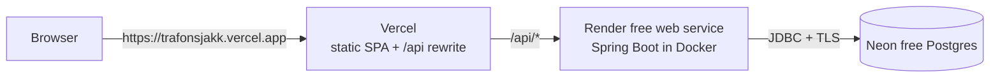

# Deployment plan (free tiers)



| Piece | Host | Free-tier notes (check current terms before relying on them) |
|---|---|---|
| Frontend | **Vercel** Hobby | Static hosting + rewrites. No server code. |
| API | **Render** free web service | 512 MB RAM, 0.1 CPU, 750 instance-hours per month. **Sleeps after 15 min without traffic; the first request after that takes about a minute.** |
| Database | **Neon** Free | 1 GB storage and 100 compute-hours per project per month; compute scales to zero after 5 min idle and wakes in about a second. Doesn't expire. |

> **Why not Render Postgres?** Render's free database is deleted 30 days after creation. Neon's free tier doesn't expire.
>
> **Why not run Spring Boot on Vercel?** Vercel runs serverless functions, not long-running JVM servers. The API needs a container host.

Vercel proxies `/api/*` to Render, so the browser only ever talks to the Vercel domain. That keeps the auth cookies first-party (no third-party-cookie problems in Safari or Firefox) and means **no CORS configuration**.

---

## Step 1: Database (Neon)

1. Sign up at <https://neon.tech> → **Create project**.
   - Region: pick the one closest to your Render region (e.g. *AWS Europe Central 1 (Frankfurt)* with Render *Frankfurt*).
   - Postgres version: 16 or newer.
2. Open **Connect** and turn **Connection pooling off** (use the direct host). Flyway and Hibernate work best on a direct connection.
3. Note the host, database name, user and password. Build the JDBC URL:

   ```
   jdbc:postgresql://<host>/<database>?sslmode=require
   ```

   e.g. `jdbc:postgresql://ep-cool-name-123456.eu-central-1.aws.neon.tech/neondb?sslmode=require`

   The username and password go in **separate** variables, not in the URL.

## Step 2: API (Render)

1. Push this repository to GitHub (see [secret check](#before-you-push) below).
2. On <https://render.com>: **New → Blueprint**, pick the repository. Render reads [`render.yaml`](../render.yaml) and proposes the `trafonsjakk-api` service (Docker, free plan, Frankfurt).
3. Fill in the variables it asks for:

   | Variable | Value |
   |---|---|
   | `DATABASE_URL` | the JDBC URL from step 1 |
   | `DATABASE_USERNAME` | Neon user |
   | `DATABASE_PASSWORD` | Neon password |
   | `BOOTSTRAP_INVITE_CODE` | a long random phrase, e.g. from `openssl rand -base64 18`. You'll use it once. |

   `JWT_SECRET` is generated automatically by the blueprint (`generateValue: true`). `SPRING_PROFILES_ACTIVE=prod` is preset.
4. **Apply**. The first build takes a few minutes. When it's live, open `https://<your-service>.onrender.com/actuator/health` and expect `{"status":"UP"}`.

<details>
<summary>Without the blueprint (manual setup)</summary>

**New → Web Service** → your repo → Runtime **Docker**, Dockerfile path `backend/Dockerfile`, Docker build context `backend`, Instance type **Free**, Health check path `/actuator/health`. Add the variables above, plus `SPRING_PROFILES_ACTIVE=prod` and `JWT_SECRET` (generate with `openssl rand -base64 48`).
</details>

## Step 3: Point the frontend at the API

Edit [`frontend/vercel.json`](../frontend/vercel.json) and replace the rewrite destination with your Render URL:

```json
{ "source": "/api/:path*", "destination": "https://<your-service>.onrender.com/api/:path*" }
```

Commit and push. (The URL isn't a secret, and Vercel rewrites can't read environment variables, so it lives in the file.)

## Step 4: Frontend (Vercel)

1. On <https://vercel.com>: **Add New → Project**, import the repository.
2. **Root Directory: `frontend`**. Vercel detects Vite; build command `npm run build`, output `dist` (both already set in `vercel.json`).
3. No environment variables are needed.
4. **Deploy.** You get `https://<project>.vercel.app`.

## Step 5: First login and lock-down

1. Open `https://<project>.vercel.app/register` and register using your `BOOTSTRAP_INVITE_CODE` as the invite code. Because the database is empty, this account becomes **admin**.
2. In Render, **delete `BOOTSTRAP_INVITE_CODE`** and save (the service restarts). It only ever works on an empty database, but there's no reason to keep it.
3. Go to **Invites** and create a code for each friend.

## Step 6 (optional): Nice-to-haves

- **Custom domain:** add it in Vercel → Project → Domains. Nothing changes on Render.
- **Avoid cold starts on chess night:** enable `.github/workflows/keep-warm.yml` (instructions inside). One always-on free instance uses about 744 of the 750 monthly hours, so only do this for one service.
- **Backups:** Neon keeps a short restore window on the free plan. For peace of mind, run a periodic `pg_dump` from your own machine:
  `pg_dump "postgresql://<user>:<password>@<host>/<db>?sslmode=require" > trafonsjakk-$(date +%F).sql` (and don't commit the output).

---

## Before you push

- `git status` should show **no** `.env`, `.env.local` or `application-local.yml` files. They're git-ignored, but check anyway.
- Real secrets live **only** in Render's environment settings: `JWT_SECRET`, the `DATABASE_*` values and `BOOTSTRAP_INVITE_CODE`.
- The only credential-looking values in the repo are the documented local-dev placeholders (`trafonsjakk` DB password, `dev-only-insecure-jwt-secret…`, `let-me-in`). The prod profile refuses to start with the dev JWT secret.
- CI runs gitleaks on every push and fails the build if anything secret-shaped shows up.

## Updating

Push to `main`. Render rebuilds the API when `backend/**` changes (`buildFilter` in `render.yaml`); Vercel rebuilds the frontend. Flyway applies any new migrations on startup. Add new migrations as `V2__description.sql` and never edit an applied one.

## Operating notes

| Situation | What happens |
|---|---|
| First visit after the API slept | The page shows skeletons while queries retry for up to about 50 s. Render wakes in roughly a minute; refresh if it takes longer. |
| Pending games while everything sleeps | Auto-confirm (48 h) runs on a schedule, on startup and before reads, so overdue games are confirmed the next time anyone opens the app. |
| Need to fix ratings | Admin → **Recompute ratings** replays every confirmed game. This is safe to run at any time. |
| Rotate `JWT_SECRET` | Change it in Render. Everyone is logged out once; nothing else is affected. |
| Leaked DB password | Reset it in Neon, update `DATABASE_PASSWORD` in Render. |

## Scaling past the free tier

Everything is stateless except the in-memory login-attempt counters (fine for one instance). If you run more than one API instance, move rate limiting to the database or Redis. Ratings recompute is serialised with a Postgres advisory lock, so it's already multi-instance safe.
